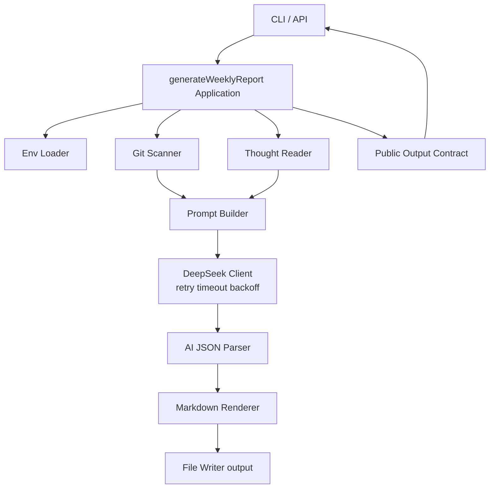

# Git Weekly Insight 架构

[返回项目首页](../README.md)

## 架构图


## 目录结构
```text
.
├─ src/app/api/weekly-report        # API 入口
├─ src/bin                          # CLI 和性能检查脚本
├─ src/lib/config                   # 环境变量加载与校验
├─ src/lib/git                      # 仓库扫描与 commit 采集
├─ src/lib/notes                    # 本地笔记读取
├─ src/lib/prompt                   # Prompt 组装
├─ src/lib/ai                       # DeepSeek 调用与重试策略
├─ src/lib/report                   # 编排、解析、渲染、输出契约
├─ src/lib/utils                    # 结构化日志
├─ src/types                        # 类型定义
├─ output                           # 生成报告目录
└─ .github/workflows                # CI/自动审查工作流
```
